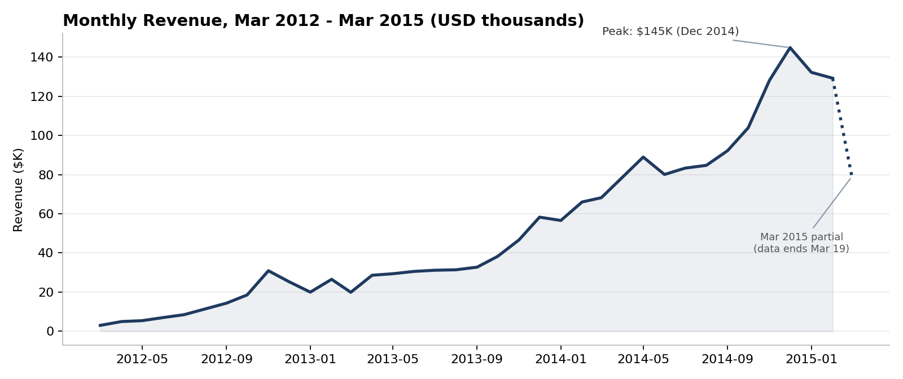
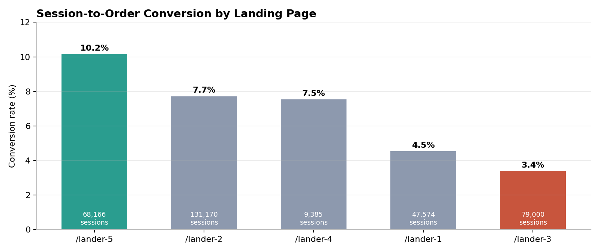
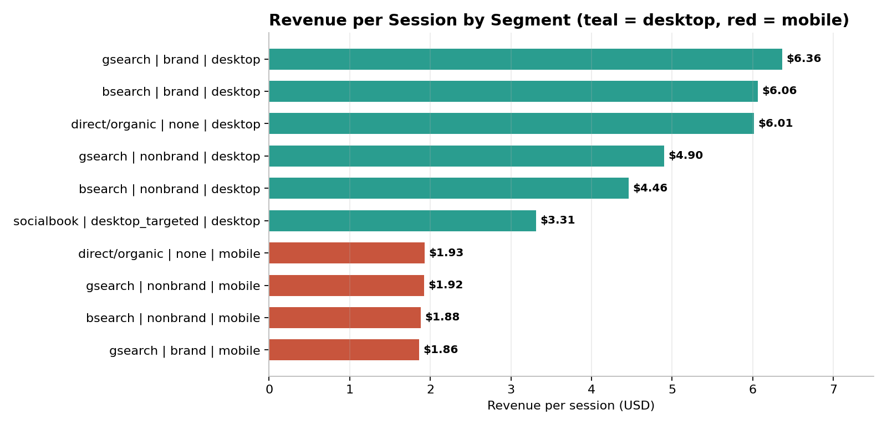

# Marketing Attribution and Customer Acquisition Funnel Analysis

---

## Executive Summary

An online toy retailer was growing quickly but had no clear view of which traffic sources, devices and landing pages actually produced revenue. This project uses 22 SQL queries over 472,871 sessions and 32,313 orders to attribute revenue to channels, map the checkout funnel, and measure customer lifetime value by acquisition source.

**Core Impact:** Identified a **3.0x conversion gap** between the best and worst landing pages (10.2% vs 3.4%) and a **2.6x revenue-per-session gap** between desktop and mobile traffic, isolating the highest-return levers across **$1.94M** in total revenue.

---

## Visual Summary

| Landing Page Conversion | Revenue per Session by Segment |
|:---:|:---:|
|  |  |

---

## Business Question

How can the business allocate marketing spend and fix funnel leakage to grow revenue per session, using channel, device, landing page and customer lifetime behavior?

---

## Tech Stack

| Layer | Tools |
|:---|:---|
| Database and Querying | Microsoft SQL Server|
| SQL Techniques | CTEs, window functions (`LAG`, `DENSE_RANK`, `ROW_NUMBER`, running totals), correlated subqueries, conditional aggregation, cohort analysis |
| Validation and Charts | Python (`pandas`, `matplotlib`) |

---

## Dataset

The dataset consists of six related tables plus a data dictionary, provided as CSV files.

| Table | Rows | Description |
|---|---|---|
| `website_sessions` | 472,871 | One row per session, with traffic source, campaign, device type, and repeat-session flag |
| `website_pageviews` | 1,188,124 | One row per pageview, with the page URL |
| `orders` | 32,313 | One row per order, with items purchased, price, and cost of goods |
| `order_items` | 40,025 | One row per product line item within an order |
| `order_item_refunds` | 1,731 | One row per refunded item, with refund amount |
| `products` | 4 | Product catalog |

---

## Key Findings

| # | Finding | Evidence |
|:---:|:---|:---|
| 1 | **Landing page choice drives a 3x conversion spread** | `/lander-5` converts at **10.2%** versus **3.4%** for `/lander-3`. The biggest funnel drop for every page is landing to cart (only 14.5% to 26.5% continue). |
| 2 | **Mobile monetizes far worse than desktop** | Average order value is nearly identical ($60.50 vs $59.91), but conversion is about **3.2% on mobile vs 8.2% on desktop** for gsearch nonbrand. Revenue per session is **$1.92 vs $4.90**. |
| 3 | **Brand desktop traffic is the highest-value segment** | gsearch brand desktop earns **$6.36 per session** at a 10.5% conversion rate, ahead of gsearch nonbrand desktop at $4.90 with 195,155 sessions of scale. |
| 4 | **Socialbook is the weakest channel** | **3.2% conversion** vs 6.8% to 7.3% for other sources, and the lowest ARPU ($3.20 vs $4.92 to $5.16) and repeat purchase rate (1.1% vs 1.7% to 1.9%). |
| 5 | **Cross-sell is a major growth lever** | Orders with 2 items rose from 0% in 2012 and 2.2% in 2013 to **33.9% in 2014**. 2014 revenue reached $1.08M, up **173%** from 2013. |
| 6 | **Product mix and refund risk differ sharply** | The Original Mr. Fuzzy generates **62.5%** of revenue and was the top product every year. Refund rates range from **6.0%** (Birthday Sugar Panda) and 5.1% (Mr. Fuzzy) down to 1.3% (Hudson River Mini bear). |
| 7 | **Reliance on repeat customers is rising** | Repeat-session share of revenue grew from **12.4% (2012) to 22.2% (2015 YTD)**. Repeat sessions convert better (7.8% vs 6.6%), yet only 1.9% of customers ever place a second order. |

Additional context: gross margin improved from 61.0% in 2012 to 63.4% in 2015 (62.7% overall), and the duplicate check on `order_items` returned zero duplicate rows.

---

## Data Pipeline and Methodology

| Step | Stage | Focus |
|:---:|:---|:---|
| 1 | Core Aggregation (Q1 - Q9) | Orders and revenue by period, traffic source, device and product; NULL source handling; conversion by `utm_source` |
| 2 | Profitability and Trends (Q10 - Q15) | Above-average products, monthly gross margin, refund rates, running revenue, yearly product rank, month-over-month growth |
| 3 | Customer and Data Quality (Q16 - Q18) | Cohort repeat-purchase rates, top landing pages per source, duplicate detection on `order_items` |
| 4 | Funnel and Attribution (Q19 - Q22) | Landing page to purchase funnel, customer lifetime value by acquisition channel, segment-level conversion and revenue per session, repeat-session revenue share |
| 5 | Validation and Visualization | Headline figures reproduced independently in Python; charts generated with `matplotlib` |

**Dataset Note:** E-commerce data (7 tables): 472,871 sessions, 1,188,124 pageviews, 32,313 orders, 40,025 order items, 1,731 refunds. Covers 19 March 2012 to 19 March 2015. Raw CSVs are not committed because of file size.

---

## Strategic Recommendations

| Priority | Recommendation | Rationale |
|:---:|:---|:---|
| 1 | **Shift spend toward desktop segments** | Prioritize gsearch and bsearch brand desktop ($6.06 to $6.36 per session), then gsearch nonbrand desktop for scale. Cap or reduce mobile bids until mobile conversion improves. |
| 2 | **Standardize on the best landing page** | Route traffic to the `/lander-5` pattern and retire `/lander-3` and `/lander-1`. Test cart-entry prompts, since landing to cart is the largest drop-off. |
| 3 | **Overhaul the mobile checkout experience** | Equal order values show the problem is friction, not purchase intent. Audit mobile page speed, cart access and billing flow. |
| 4 | **Reduce or reprice Socialbook** | Lowest conversion, ARPU and repeat rate. Reallocate budget to search channels unless creative and targeting are rebuilt. |
| 5 | **Expand cross-sell and fix refund-heavy products** | Extend bundle offers at cart. Investigate quality or expectation gaps behind the 6.0% and 5.1% refund rates. |
| 6 | **Build a retention program** | A 1.9% repeat purchase rate leaves lifetime value on the table. Target post-purchase email at the 22% of revenue that already comes from returning visitors. |

---

## Notes and Limitations

- **Landing page comparison is time-confounded.** Landing pages ran in different date windows (for example `/lander-4` ran only from February to April 2014), so conversion differences may partly reflect seasonality and traffic mix rather than page design alone. A controlled A/B test would confirm the ranking.
- **March 2015 is a partial month** (data ends 19 March) and should not be read as a revenue decline.
- **The NULL `utm_source` group** combines direct and organic traffic and cannot be separated with the available fields.
- **Revenue per session** is computed on all sessions, including those that never converted.

---

## Repository Structure

| Path | Description |
|:---|:---|
| `marketing-attribution-customer-acquisition-funnel-analysis.sql` | All T-SQL queries covering aggregation, window functions, cohorts, funnel and attribution analysis. |
| `assets/` | Charts used in this README. |
| `README.md` | Project documentation and executive summary. |
